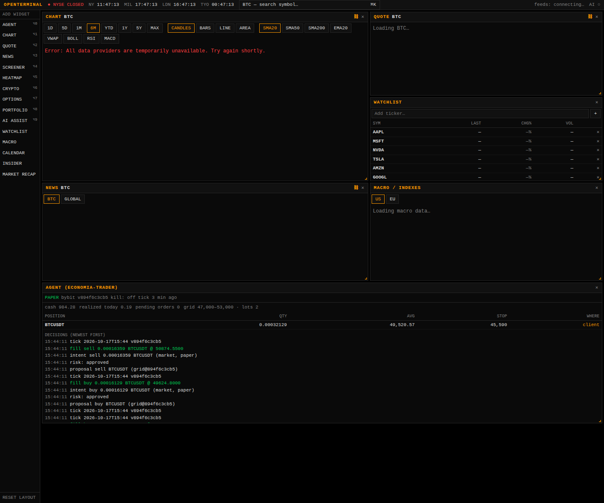

# Revisão do economia-trader face ao OpenTerminal (e o que entrou)

**Data:** 2026-10-17 · **Pedido do maestro:** "revisão e complementa o que faltou, incluindo esse projecto, parcial
ou integral, para complementar ou substituir". · **Origem:**
[ErTasselli/OpenTerminal](https://github.com/ErTasselli/OpenTerminal) (MIT, `aed097c`), lido e auditado antes de
entrar.

## Resumo

O economia-trader e o OpenTerminal resolvem metades diferentes do mesmo problema:

- o **economia-trader** é o agente: decide, mede o risco, executa (paper/testnet), regista, alerta e aprende
  (`tune`). Não tinha uma forma boa de **ver o mercado**; o painel era uma página estática do estado do agente;
- o **OpenTerminal** é a vista do mercado: gráficos, mapa de calor, screener, cotações, macro, calendários,
  notícias. Não negoceia nem sabe que o agente existe.

Por isso entrou **integral, como complemento**: o terminal fica em `oss/economia-trader/terminal/` e passa a ver o
agente através de um widget **AGENT**, só de leitura. Só uma coisa do OpenTerminal entra no **cérebro** do agente: o
calendário económico, e apenas para **pausar** entradas, nunca para as abrir. Os preços para decidir continuam a
vir da própria exchange.

> Os gráficos aparecem com erro na imagem porque a rede da sessão onde foi tirada bloqueia os fornecedores de
> dados. O widget AGENT está a ler uma pasta de estado real, gerada por 5 ticks do grid em paper.

## Matriz: o que havia, o que faltava e o que fica de cada lado

| Área | economia-trader (antes) | OpenTerminal | Decisão | Estado |
|---|---|---|---|---|
| Execução, risco, gate, kill switch, diário com cadeia de hashes | ✔ núcleo | ✘ não negoceia | Fica nosso | — |
| Estratégias (grid, SMA, whale screen), backtest, `tune` | ✔ | ✘ | Fica nosso | — |
| Analistas LLM (TradingAgents, ai-hedge-fund), Kronos | ✔ opcionais | assistente Claude (pago) | Ficam os nossos; o assistente dele só liga com `ANTHROPIC_API_KEY` | — |
| Alertas (Telegram, webhook, e-mail) | ✔ #198 | ✘ | Fica nosso | — |
| **Ver o agente** (posições, stops, decisões, alertas) | `dashboard.py` estático | ✘ | **Complementar**: widget AGENT no terminal; o `dashboard.py` fica como vista estática sem Node | **feito** |
| **Agente parado sem ninguém ver** (lacuna V1 da auditoria #201) | ✘ | ✘ | Card "Último tick" no painel (`SEM ATUALIZAÇÃO` acima de 15 min) e `STALE` no widget | **feito** |
| **Sinais do #198/#199 visíveis** (lacuna V2) | só na linha do tempo | ✘ | O widget mostra o stop na exchange ou no cliente, as ordens pendentes, as divergências livro↔exchange, os stops degradados e os alertas, a vermelho | **feito** |
| **Ver o mercado**: gráficos e indicadores, cotação com fundamentais, mapa de calor, screener, opções, cripto, macro (curva, VIX), notícias, insiders, recap | ✘ | ✔ | **Incorporar** o terminal tal como está | **feito** |
| **Calendário económico com consenso** (Fed, ECB, CPI, NFP…) | ficheiro FOMC à mão + BLS via OpenBB | ✔ Forex Factory + FRED | **Incorporar no agente** só para pausar: `monitor --econ-calendar` → `macro_block` | **feito** |
| Calendário de resultados (earnings) | ✘ | ✔ visível | Fica visível no terminal; pausar ações antes de resultados é a decisão D2 | proposta |
| Carteira manual (SQLite) | n/a (o diário é a verdade) | ✔ | Fica no terminal para carteira manual; não se mistura com o agente | — |
| Preços para **decidir** | exchange (ccxt, alpaca-py) | endpoints públicos não oficiais | **Não substituir**: o terminal mostra, a exchange decide | — |
| Terminal externo ligado por link | OpenStock (AGPL, só link) | — | O OpenTerminal (MIT, integrado) passa a ser o recomendado; `--openstock-url` continua | **feito** |
| Escritório pixel (Star-Office-UI) | opcional, arte não comercial | — | Fica opcional, sem mudanças | — |
| TV ao vivo | — | ✔ | **Removida**: a CNBC e a Cheddar vinham de um restream de terceiros (`tier1streams.com`) | **feito** |

## O que foi feito (PR desta revisão)

1. **Terminal incluído** em `oss/economia-trader/terminal/`, com proveniência fixa (`PROVENANCE.md`):
   - **Segurança:** dependências de produção de 6 avisos (1 crítico, 3 altos) para **0** (`next` 16.4,
     `fast-xml-parser` 5); semgrep com as regras do CI a 0; servidor só em `127.0.0.1`.
   - **Removido:** a TV ao vivo.
2. **Ponte só de leitura:**
   - `GET /api/agent` lê o `state.json`, o `journal.jsonl` (só a cauda) e o `alerts.jsonl` da pasta em
     `ECONOMIA_TRADER_STATE_DIR`.
   - Está protegida pela mesma chave do portfolio, porque as posições são privadas; sem a chave, responde 401.
   - Retira campos com nome de segredo e nenhum parâmetro do pedido escolhe que ficheiro é lido.
   - Tem 6 testes.
3. **Widget AGENT** (⌥0, no layout por defeito):
   - mostra o modo, o kill switch, o caixa, as posições com o stop e onde ele está (exchange ou cliente), as ordens
     pendentes, o grid, o último tick com `STALE`, as decisões e os alertas;
   - clicar numa posição abre esse ativo no gráfico.
4. **Link directo** `/?symbol=SYM`: o `dashboard --openterminal-url` liga cada ticker ao terminal, e `BTCUSDT` abre
   `BTC`.
5. **Calendário económico no agente:**
   - `economia-trader monitor --econ-calendar [--econ-countries USD,EUR]` lê o feed público do Forex Factory.
   - Só o host oficial é aceite. A flag de impacto do próprio fornecedor decide o que é "alto impacto".
   - O `macro_block` já existente pausa entradas à volta dessas divulgações.
6. **CI próprio:** `.github/workflows/economia-trader-terminal.yml` corre os testes do servidor, os builds com
   typecheck e o `npm audit` de produção, que falha em high ou critical.

## Decisões do maestro (2026-10-17: seguiu as recomendações, A nas três)

- **D1. Papel do `dashboard.py`: decidida A.**
  - **A) Fica como vista estática** (sem Node, gerada pelo cron), e o terminal é a interface do dia a dia.
    **RECOMENDADA:** o painel funciona offline e em qualquer browser, e não depende de fornecedores não oficiais.
  - **B) Substituí-lo pelo terminal.** Obrigaria a ter Node e o terminal a correr para ver o agente.
  - **C) Retirá-lo.** Perde-se a vista mínima que funciona sempre.
- **D2. Pausar ações antes de resultados (earnings): decidida A** (fica para depois do smoke testnet, #201).
  - **A) Proposta para depois do smoke testnet**, com um `earnings_block` igual ao `macro_block`, alimentado por um
    calendário. **RECOMENDADA**, porque só acrescenta cautela; a fonte (Nasdaq, não oficial) tem de ser avaliada
    antes.
  - **B) Já.**
  - **C) Nunca.**
- **D3. Assistente de IA do terminal: decidida A** (sem `ANTHROPIC_API_KEY`, fica desligado; não há código a mudar).
  - **A) Desligado.** **RECOMENDADA:** custa dinheiro (API da Anthropic) e duplica os nossos analistas.
  - **B) Ligá-lo à API da Anthropic.**
  - **C) Adaptá-lo ao Gemini no plano grátis.** Exige mexer no código dele.

## Limites honestos

- **Dados não oficiais:** os endpoints de mercado do terminal são públicos mas não licenciados, e podem mudar ou
  falhar. Servem para ver, não para executar, e o uso comercial exige rever os termos de cada fonte.
- **Ainda sem provas com dados reais:**
  - nesta sessão a rede bloqueia os fornecedores, por isso os gráficos e cotações nunca foram vistos com dados
    reais;
  - o widget AGENT foi provado com uma pasta de estado real (grid em paper, cliente offline) e com um screenshot;
  - o calendário foi provado com fixtures.
- **Workspace guardado:** quem já tinha o terminal com um workspace guardado no browser não vê o widget AGENT
  automaticamente. Adiciona-se pela barra lateral (⌥0) ou com RESET LAYOUT.
